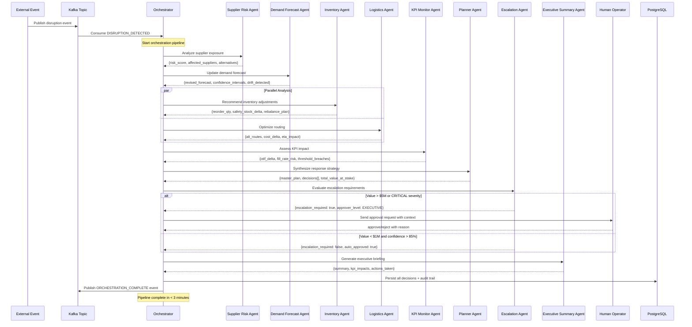
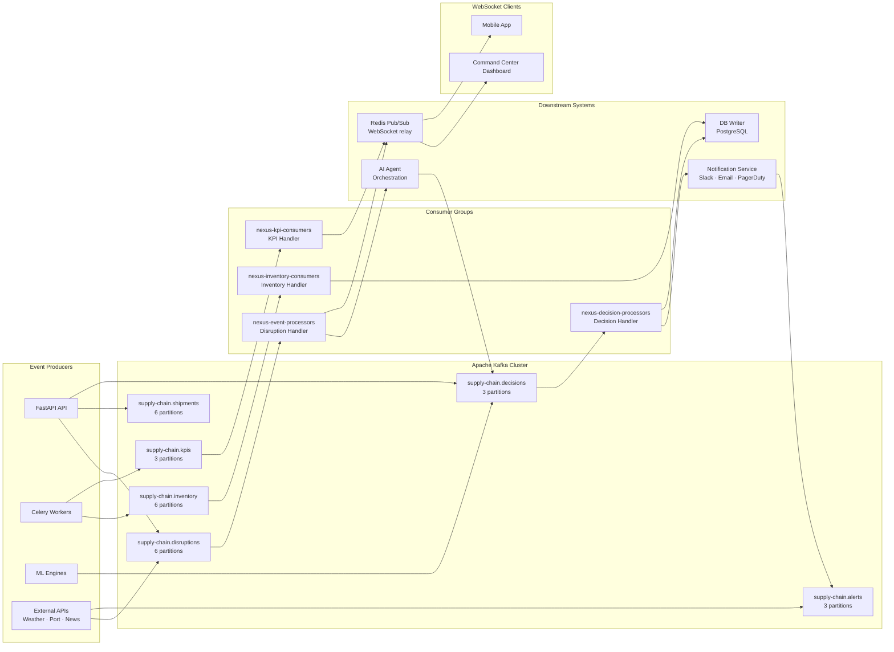
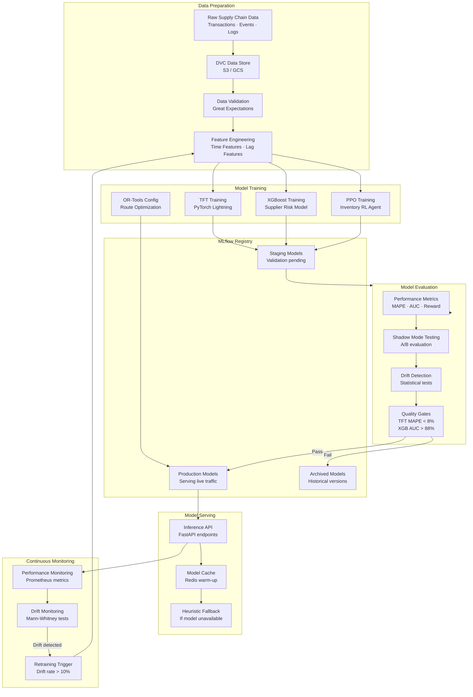
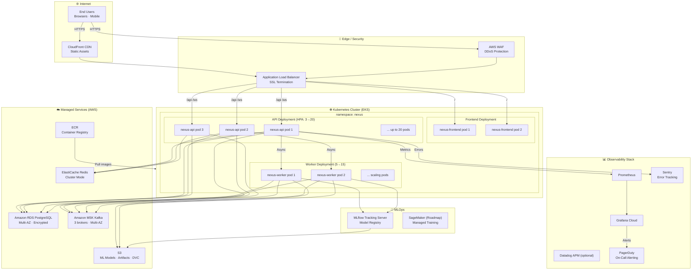

# NEXUS Supply Chain Control Tower — Architecture Diagrams

## System Architecture

```mermaid
graph TB
    subgraph CLIENT["🖥️ Client Layer"]
        FE["Next.js 14 Frontend<br/>TypeScript · Tailwind · ShadCN"]
        MOBILE["Mobile App<br/>React Native (Roadmap)"]
    end

    subgraph GATEWAY["🔀 API Gateway / Reverse Proxy"]
        NGINX["NGINX<br/>SSL · Rate Limiting · Load Balancing"]
    end

    subgraph API["⚡ Application Layer"]
        FASTAPI["FastAPI Backend<br/>REST + WebSocket · JWT Auth · RBAC"]
        CELERY["Celery Workers<br/>Async Task Processing"]
        BEAT["Celery Beat<br/>Scheduled Jobs"]
    end

    subgraph AGENTS["🤖 Multi-Agent AI Layer"]
        ORCH["LangGraph Orchestrator<br/>Master Workflow Engine"]
        PLAN["Planner Agent<br/>Strategy Synthesis"]
        INV["Inventory Agent<br/>Stock Optimization"]
        LOG["Logistics Agent<br/>Route Planning"]
        RISK["Supplier Risk Agent<br/>XGBoost Scoring"]
        DEMAND["Demand Forecast Agent<br/>TFT Model Inference"]
        ESC["Escalation Agent<br/>Human-in-the-Loop"]
        KPI["KPI Monitor Agent<br/>Threshold Alerting"]
        EXEC["Executive Summary Agent<br/>C-Suite Reporting"]
    end

    subgraph STREAMING["📡 Event Streaming"]
        KAFKA["Apache Kafka<br/>Event Bus · 6 Topics"]
        ZK["Zookeeper<br/>Cluster Coordination"]
        REDIS["Redis<br/>Cache · Pub/Sub · Sessions"]
    end

    subgraph ML["🧠 ML Engine Layer"]
        TFT["TFT Demand Forecasting<br/>PyTorch · 28-Day Horizon"]
        RL["RL Inventory Optimizer<br/>PPO · Stable-Baselines3"]
        VRP["Route Optimizer<br/>OR-Tools VRP Solver"]
        XGBOOST["Supplier Risk Model<br/>XGBoost + Graph Analytics"]
        GRAPH["Network Graph<br/>NetworkX · Cascade Simulation"]
    end

    subgraph DATA["💾 Data Layer"]
        PG["PostgreSQL 16<br/>Primary Database"]
        MLFLOW["MLflow<br/>Model Registry · Experiment Tracking"]
        DVC["DVC<br/>Data Version Control"]
    end

    subgraph OBS["📊 Observability"]
        PROM["Prometheus<br/>Metrics Collection"]
        GRAFANA["Grafana<br/>Dashboards · Alerting"]
        ELK["ELK Stack<br/>Centralized Logging"]
    end

    subgraph INFRA["☸️ Infrastructure"]
        K8S["Kubernetes 1.28<br/>Container Orchestration"]
        HPA["HPA<br/>Auto-scaling 3→20 pods"]
        GHACTIONS["GitHub Actions<br/>CI/CD Pipeline"]
    end

    FE -->|HTTPS/WSS| NGINX
    MOBILE -->|HTTPS| NGINX
    NGINX -->|HTTP| FASTAPI
    FASTAPI -->|Async tasks| CELERY
    BEAT -->|Schedules| CELERY
    FASTAPI -->|Orchestrate| ORCH
    ORCH --> PLAN
    ORCH --> INV
    ORCH --> LOG
    ORCH --> RISK
    ORCH --> DEMAND
    ORCH --> ESC
    ORCH --> KPI
    ORCH --> EXEC
    FASTAPI -->|Publish| KAFKA
    KAFKA -->|Subscribe| CELERY
    KAFKA --- ZK
    FASTAPI -->|Cache/PubSub| REDIS
    INV -->|Inference| RL
    LOG -->|Optimize| VRP
    RISK -->|Score| XGBOOST
    RISK -->|Graph| GRAPH
    DEMAND -->|Forecast| TFT
    FASTAPI -->|Read/Write| PG
    CELERY -->|Read/Write| PG
    TFT -->|Track| MLFLOW
    RL -->|Track| MLFLOW
    XGBOOST -->|Track| MLFLOW
    FASTAPI -->|Metrics| PROM
    PROM -->|Visualize| GRAFANA
    FASTAPI -->|Logs| ELK
    K8S -->|Runs| FASTAPI
    K8S -->|Runs| CELERY
    HPA -->|Scales| K8S
    GHACTIONS -->|Deploy| K8S
```

---

## Agent Orchestration Flow

---

## Event Streaming Architecture

---

## ML Model Lifecycle

---

## Deployment Architecture

