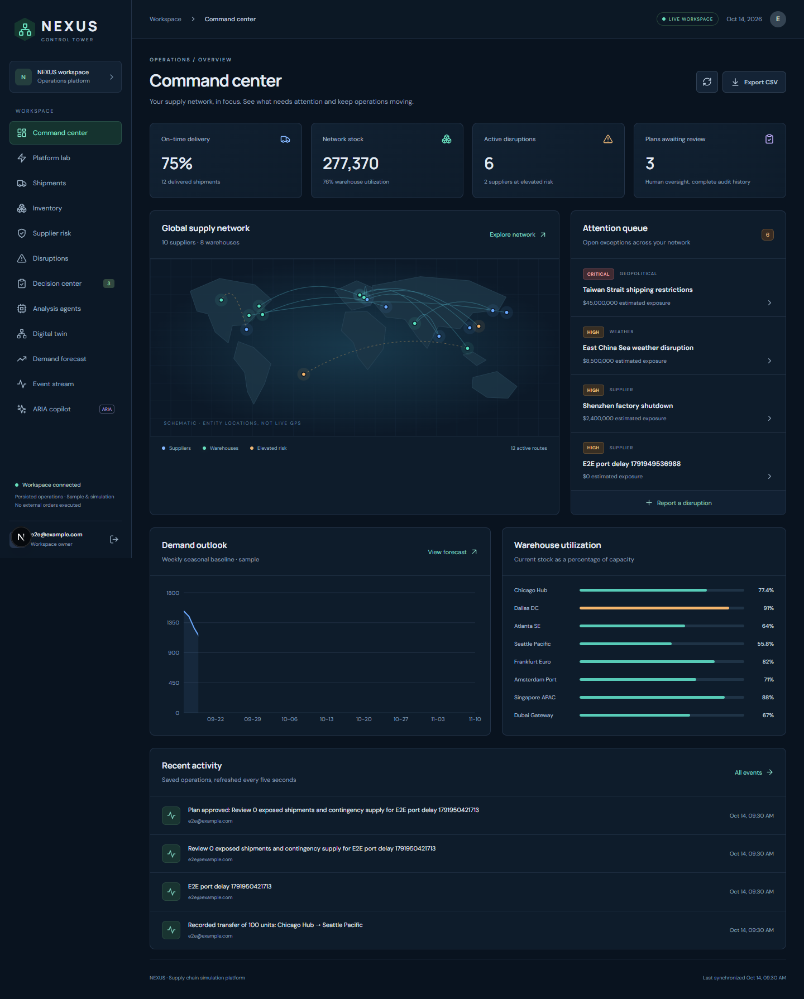
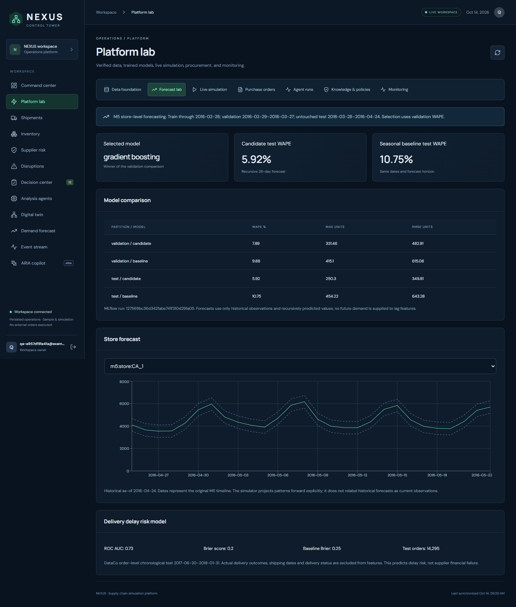
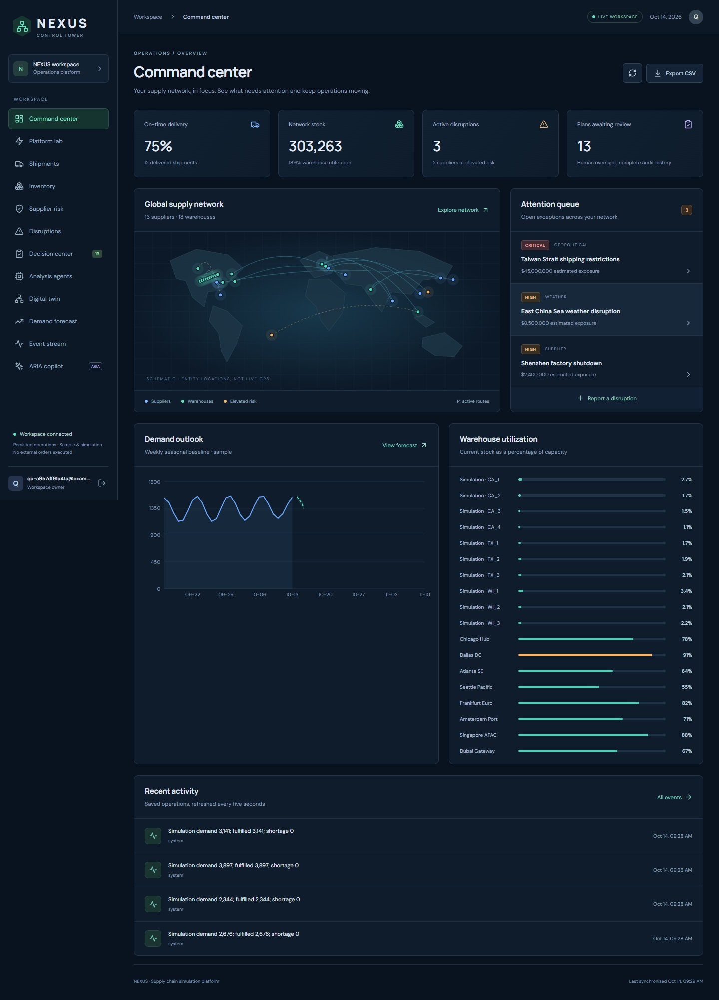
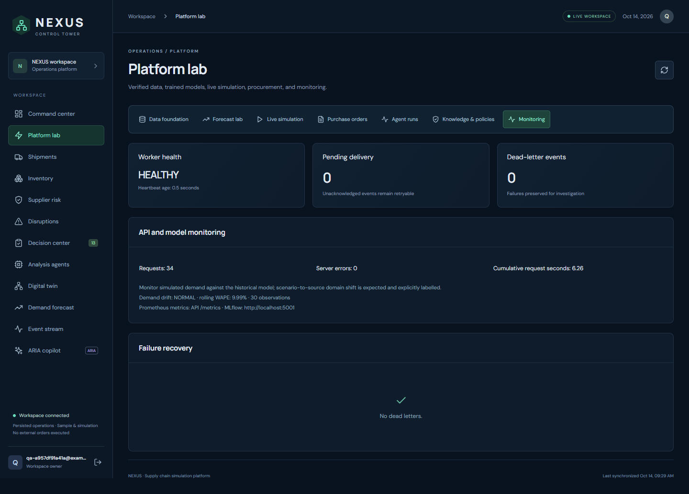
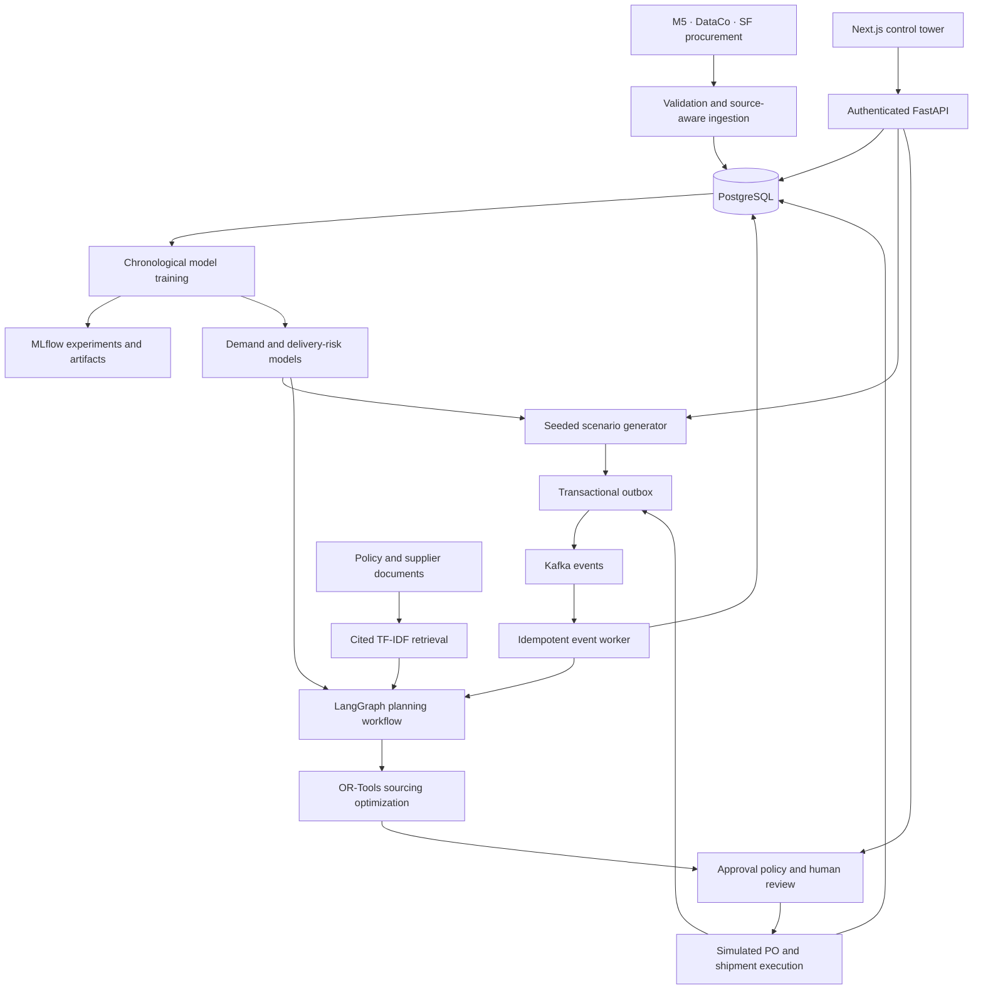

<div align="center">

# NEXUS
### Supply Chain Control Tower

**Forecast demand. Detect delivery risk. Optimize purchasing. Review decisions. Simulate execution.**

An end-to-end supply-chain intelligence platform connecting historical data, machine learning, event processing, and approval-controlled operations.

[Getting started](#getting-started) · [Architecture](#architecture) · [Model results](#model-results) · [Demo walkthrough](#demo-walkthrough) · [Documentation](#documentation)

</div>



> **Project scope:** A working local simulation platform. Historical datasets, trained models, database transactions, and Kafka events are real; future scenarios, supplier allocations, purchase orders, and carrier actions execute inside a simulated operating environment.

## Overview

Supply-chain teams need to move from identifying a problem to taking an accountable action. NEXUS demonstrates that entire workflow: it forecasts demand, assesses delivery risk, identifies replenishment needs, allocates orders across suppliers, applies approval policies, and updates operational state after simulated execution.

The system combines a **Next.js dashboard**, **FastAPI services**, **PostgreSQL**, **Kafka**, **MLflow**, **LangGraph**, and **OR-Tools**. It runs locally with Docker and does not require a paid LLM API key.

### At a glance

| Area | Implementation |
| :--- | :--- |
| Historical data | 3,049 M5 products, 10 stores, and 30,490 product/store series |
| Imported demand | 11,128,850 product/day observations in the verified 365-day import |
| Forecasting | 28-day recursive forecasts with chronological validation and testing |
| Forecast result | **5.92% test WAPE**, compared with **10.75%** for the seasonal baseline |
| Decision workflow | Seven LangGraph steps with model provenance, retrieved citations, and persisted reports |
| Execution | Policy-controlled simulated purchasing and shipment changes, followed by replanning |
| Reliability | Transactional outbox, duplicate-event protection, retries, and dead-letter handling |

## Contents

- [Features](#features)
- [Screenshots](#screenshots)
- [Architecture](#architecture)
- [Technology stack](#technology-stack)
- [Data sources](#data-sources)
- [Model results](#model-results)
- [Getting started](#getting-started)
- [Demo walkthrough](#demo-walkthrough)
- [Testing and verification](#testing-and-verification)
- [Operations](#operations)
- [Repository structure](#repository-structure)
- [Scope and limitations](#scope-and-limitations)
- [Documentation](#documentation)

## Features

### Operational control tower

- Monitor inventory, warehouses, suppliers, shipments, and purchase orders.
- Review disruptions, transfer stock, inspect the network, and export operational data.
- Follow decisions through review, execution, and audit history.
- Use authenticated sessions and role-based permissions for protected actions.

### Forecasting and delivery-risk prediction

- Validate product/store mappings, source IDs, calendar relationships, and demand history.
- Build lag, rolling-window, and calendar features for store-level demand forecasting.
- Compare gradient boosting against a weekly seasonal baseline using WAPE, MAE, and RMSE.
- Predict delivery-delay risk with a separately trained logistics model.
- Track experiment parameters, metrics, and model artifacts in MLflow.

### Planning, retrieval, and optimization

- Coordinate forecast, risk, retrieval, inventory, optimization, planning, and summary steps through LangGraph.
- Retrieve relevant policy and supplier passages with source citations.
- Allocate integer purchase quantities with OR-Tools under demand, supplier-capacity, and budget constraints.
- Apply structured approval rules, including automatic approval limits and executive-review thresholds.

### Event-driven simulation

- Generate repeatable demand and delivery scenarios from historical patterns and recorded random seeds.
- Publish events to Kafka and update operational state in PostgreSQL.
- Execute approved simulated purchase orders or shipment changes and trigger replanning.
- Inspect worker health, event backlogs, failed events, and model-monitoring signals.

## Screenshots

### Demand forecasting

Inspect the trained forecast, held-out evaluation, and baseline comparison.



<details>
<summary><strong>View the operational dashboard and monitoring screens</strong></summary>

### Operational dashboard



### Monitoring



</details>

## Architecture



### One complete operating cycle

1. A simulation tick generates demand for a warehouse mapped to an M5 store.
2. The worker processes the event and updates available inventory.
3. The planning workflow combines forecasts, delay risk, inventory, and retrieved policy context.
4. OR-Tools proposes a feasible supplier allocation.
5. Structured policy determines whether automatic approval or human review is required.
6. Approved execution creates simulated purchase orders and shipments.
7. Execution events trigger replanning; subsequent delivery events update stock.

State changes and outgoing messages share a database transaction. An inbox records processed event IDs so redelivery does not repeat inventory effects. This provides **at-least-once messaging with idempotent processing**.

See the [architecture guide](docs/ARCHITECTURE.md) for model splits, concurrency controls, and data-flow details.

## Technology stack

| Layer | Technologies | Purpose |
| :--- | :--- | :--- |
| Frontend | Next.js, React, Recharts | Interactive dashboard and operational workflows |
| API | Python, FastAPI | Authentication, data access, planning, and execution endpoints |
| Persistence | PostgreSQL; SQLite for isolated tests | Historical data and persistent operational state |
| Messaging | Apache Kafka | Simulation, execution, and state events |
| Data and ML | pandas, NumPy, scikit-learn | Ingestion, feature engineering, forecasting, and delay prediction |
| Experiment tracking | MLflow | Parameters, metrics, and training artifacts |
| Workflow orchestration | LangGraph | Explicit planning steps and persisted reports |
| Retrieval | TF-IDF and cosine similarity | Extractive, cited policy and supplier context |
| Optimization | OR-Tools | Constrained integer sourcing allocations |
| Delivery and testing | Docker Compose, pytest, Playwright, GitHub Actions | Local deployment and automated verification |

## Data sources

The datasets remain independently identifiable. They are **not treated as records from one company**.

| Source | Use in NEXUS | Verified imported scope |
| :--- | :--- | :--- |
| [M5 forecasting competition](https://www.kaggle.com/competitions/m5-forecasting-accuracy/data) | Product/store relationships and demand forecasting | 3,049 products; 10 stores; 365 days of product-level demand; all 1,913 historical days aggregated by store |
| [DataCo supply-chain dataset](https://data.mendeley.com/datasets/8gx2fvg2k6/5) | Delivery-delay training and logistics patterns | 180,519 order lines |
| [San Francisco vendor payments by purchase order](https://data.sf.gov/d/p5r5-fd7g) | Separately identified procurement accounting records | Bounded extract of 20,000 rows |

Source manifests record provenance, hashes, and dataset grain. Normalized logistics data excludes personal columns. Scenario supplier costs and capacities are synthetic assumptions; the SF accounting records are not used as fabricated item prices.

**Attribution:** M5 inputs remain subject to competition terms. DataCo is attributed to Fabian Constante, Fernando Silva, and António Pereira under CC BY 4.0. The SF extract's manifest records PDDL attribution. Raw datasets are excluded from this repository.

## Model results

### Demand forecasting

Evaluation is at **store/day aggregate-unit level**, using a 28-day recursive forecast. Model selection uses the preceding validation period; the final test covers **March 28-April 24, 2016**.

| Model | WAPE ↓ | MAE ↓ | RMSE ↓ |
| :--- | ---: | ---: | ---: |
| Weekly seasonal baseline | 10.75% | 454.22 | 643.28 |
| Selected gradient-boosting model | **5.92%** | **250.30** | **349.81** |

Lagged and rolling features use past demand. Recursive evaluation feeds predictions back into subsequent forecast steps rather than using future actual demand. Forecast dates follow the historical data cutoff; future operating scenarios are labelled simulations.

### Delivery-delay prediction

| Metric | Logistic regression | Baseline |
| :--- | ---: | ---: |
| ROC-AUC | **0.733** | — |
| Brier score ↓ | **0.196** | 0.247 |
| Accuracy | **69.27%** | 55.05% |

Evaluation uses a chronological order-level holdout and excludes realized shipping outcomes from input features. The target is **delivery delay**, not supplier financial failure.

These are recorded local evaluation results, not promised accuracy for another company. Bootstrap regenerates model summaries and artifacts under `runtime/artifacts/`; experiments are also available in MLflow.

## Getting started

### Prerequisites

- **Git** and access to this repository.
- **Python 3.11** for the launcher and supported local development environment.
- **Docker Desktop** or Docker Engine with **Compose v2**, running with Linux containers.
- The three M5 input files listed below.
- Internet access for container images, packages, and public-source downloads.
- Sufficient disk space and time for the 11.1-million-row default import; requirements depend on your machine.

Node.js is installed inside the frontend container. Install **Node.js 20+** locally only if you want to develop or run frontend checks outside Docker.

### 1. Clone the repository

```bash
git clone https://github.com/sj4517262-coder/nexus-scct.git
cd nexus-scct
```

### 2. Add the M5 inputs

Download these files from the [M5 competition data page](https://www.kaggle.com/competitions/m5-forecasting-accuracy/data), accepting any required access terms, and arrange them as follows:

```text
data/raw/m5/
├── sales_train_validation.csv
├── calendar.csv
└── sell_prices.csv
```

### 3. Bootstrap the full platform

```bash
python scripts/deploy.py bootstrap
```

Use `python3` if that is your Python 3.11 command. The launcher:

1. Creates a local `.env.platform` with a generated database password if absent.
2. Builds and starts PostgreSQL, Kafka, and MLflow.
3. Imports and validates M5, downloads the public extracts, and trains both models.
4. Starts the API, event worker, and dashboard.

Identical imports are checked and reused. Credentials, databases, raw data, and generated model artifacts remain local and are excluded from Git.

### 4. Open the application

| Service | Address |
| :--- | :--- |
| Dashboard | [localhost:3000](http://localhost:3000) |
| API documentation | [localhost:8000/docs](http://localhost:8000/docs) |
| MLflow | [localhost:5001](http://localhost:5001) |

Create your owner account in the dashboard. **There are no default credentials.**

### Subsequent starts

```bash
python scripts/deploy.py up
```

Use `bootstrap` for a fresh installation; `up` starts an already prepared environment. If data or model artifacts are missing, run bootstrap after supplying the M5 files.

## Demo walkthrough

| Step | Screen | What to demonstrate |
| :--- | :--- | :--- |
| 1 | Platform lab → Data foundation | Source provenance, mapping checks, and imported data counts |
| 2 | Demand forecasting | Trained forecasts, evaluation metrics, and baseline comparison |
| 3 | Platform lab → Simulation | Advance a scenario by one day or seven days |
| 4 | Decision center | Inspect a generated simulation plan and review it when required |
| 5 | Purchase orders / Shipments | Follow the persisted simulated execution |
| 6 | Agent runs / Event stream | Inspect planning evidence and resulting events |
| 7 | Knowledge & policies / Monitoring | Show cited retrieval, worker status, and failed-event handling |

Use executable **simulation plans** for the purchase-order demonstration. Sample narrative disruption plans are bookkeeping workflows and do not represent real supplier execution.

## Testing and verification

The saved [verification report](docs/VALIDATION.md) records **42 backend tests**, **3 browser workflows**, frontend lint/build, full-stack simulation, Kafka recovery, worker restart, and a database backup restore. The backend suite also passed again during the October 17, 2026 GitHub preparation. Those results describe the checked environment, not every future installation.

[GitHub Actions](https://github.com/sj4517262-coder/nexus-scct/actions/workflows/ci.yml) runs backend tests, frontend lint/build, and browser workflows on pushes and pull requests.

### Run checks locally

Create a Python 3.11 environment:

```bash
python -m venv .venv
```

Activate it with `.venv\Scripts\Activate.ps1` in PowerShell, or `source .venv/bin/activate` on macOS/Linux. Then run:

```bash
python -m pip install -r requirements-platform.txt
npm ci
python -m pytest -q
npm run lint
npm run build
npx playwright install chromium
npm run test:e2e
```

Browser tests start isolated services on ports **3100** and **8100**, using a test SQLite database. They do not target the live PostgreSQL workspace.

To verify the running PostgreSQL/Kafka execution loop:

```bash
python scripts/deploy.py verify
```

This creates labelled simulation activity and verifies execution and replanning. See [operations and recovery](docs/OPERATIONS.md) before running outage or backup-restore checks.

## Operations

| Task | Command |
| :--- | :--- |
| Start prepared services | `python scripts/deploy.py up` |
| Inspect service status | `python scripts/deploy.py status` |
| Verify the simulation loop | `python scripts/deploy.py verify` |
| Back up PostgreSQL | `python scripts/deploy.py backup` |
| Stop services while preserving named volumes | `python scripts/deploy.py down` |

<details>
<summary><strong>Troubleshooting</strong></summary>

| Symptom | Check |
| :--- | :--- |
| Cannot connect to Docker | Start Docker Desktop or the Docker daemon, then retry. |
| Missing M5 file error | Verify all three exact filenames under `data/raw/m5/`. |
| Dashboard has no trained forecast | Complete bootstrap and inspect its output for import/training errors. |
| Port already in use | Check ports 3000, 8000, 5001, 5433, and 19092 for conflicting services. |
| Missing database-password variable when using Compose directly | Use the launcher, or pass `--env-file .env.platform -f docker-compose.platform.yml`. |
| Simulation is not progressing | Check worker health, event backlog, and dead letters in Monitoring. |
| Browser tests cannot locate Python or a browser | Set `NEXUS_TEST_PYTHON` to your interpreter; install Playwright Chromium or set `NEXUS_TEST_BROWSER=chrome` for installed Chrome. |

</details>

## Repository structure

```text
nexus-scct/
├── app/                         # Next.js entry points and styles
├── components/                  # Control tower and platform workspace
├── nexus/
│   ├── api.py                   # API and session-based access
│   ├── store.py                 # Persistence and transaction helpers
│   └── platform/                # Data, models, planning, simulation, execution
├── policies/                    # Structured approvals and retrieval documents
├── scripts/                     # Bootstrap, deployment, verification, packaging
├── tests/                       # Backend and browser workflow tests
├── docker/                      # Application container definitions
├── docker-compose.platform.yml  # Full local simulation stack
├── .github/workflows/ci.yml      # Automated checks
├── data/examples/               # Small example input
├── docs/                        # Architecture, API, operations, screenshots
└── output/pdf/                  # Clickable project interview handbook
```

Earlier prototype and research files are retained for history, including `README.prototype.md`, `main_research.py`, `requirements-research.txt`, and `docker-compose.research.yml`. The active application enters through **`main.py` → `nexus/api.py`**, with platform behavior under **`nexus/platform/`**.

## Scope and limitations

| Implemented | Outside the delivered scope |
| :--- | :--- |
| Historical-source ingestion and trained models | Live company ERP, warehouse, or carrier feeds |
| Persistent simulated purchase orders and shipment changes | Real purchases, payments, supplier contact, or carrier instructions |
| Store-level forecasting and aggregate replenishment | Production SKU-level replenishment |
| Explicit LangGraph workflow and cited TF-IDF retrieval | Free-form LLM decision-making or embedding-based retrieval |
| Local single-workspace Docker deployment | Multi-company tenancy, public cloud hosting, or a highly available Kafka cluster |
| Evaluation metrics and operational monitoring | Guaranteed future forecast accuracy or measured commercial savings |

Structured approval policy is authoritative; retrieved documents cannot grant execution permissions. The current stack is designed for local use. Internet deployment requires appropriate TLS, secure cookies, access controls, and production secret management.

## Documentation

| Resource | Contents |
| :--- | :--- |
| [Architecture](docs/ARCHITECTURE.md) | Data flow, model evaluation, planning, and event-processing design |
| [API guide](docs/API.md) | Application endpoints and workflow conventions |
| [Operations guide](docs/OPERATIONS.md) | Deployment, monitoring, retries, backups, and recovery |
| [Verification report](docs/VALIDATION.md) | Recorded tests, model metrics, and operating boundaries |
| [Interview handbook — PDF](output/pdf/NEXUS_Interview_Handbook.pdf) | 57 pages with clickable chapter navigation and expanded answers |
| [Interview handbook — Markdown](docs/NEXUS_Interview_Handbook.md) | GitHub-readable explanations, code walkthroughs, and exercises |
| [Interview handbook — offline HTML](docs/NEXUS_Interview_Handbook.html) | Download and open locally for search, expandable answers, and study progress |

The handbook includes **32 chapters, 60 interview questions, 9 practical exercises, a seven-day learning plan, and a five-minute demonstration script**.
