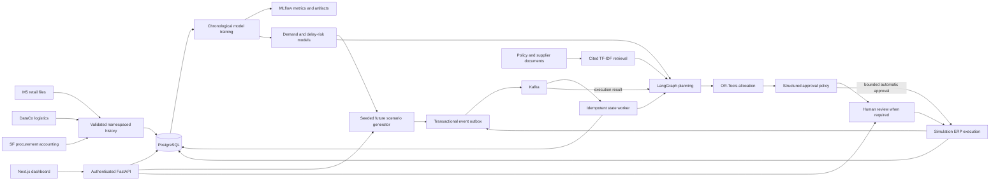

# System architecture

Source facts remain separate from scenario projections. M5 store keys map explicitly to synthetic simulation warehouses. DataCo supplies delay patterns/model training, while San Francisco purchase-order accounting is an independent procurement source. It is not used as fabricated supplier pricing. Source hashes, dates, grain and download provenance are stored with each manifest.

Demand training uses a 28-day validation interval to select between gradient boosting and a weekly seasonal baseline. The final 28-day test interval is held out. Recursive predictions use prior predictions rather than future actual demand. A final fit generates the historical-cutoff future forecast. Delay risk uses date-separated whole orders and excludes realized shipping outcomes from predictors.

Seven LangGraph nodes persist their reports, duration, citations and model provenance. OR-Tools chooses integer supplier quantities under demand, capacity and budget constraints. Planning confidence is an explicit heuristic feasibility score, not a calibrated probability; delivery-delay probability comes from the trained model. The synthetic scenario samples DataCo observed lead times and delay rates with a recorded random seed.

PostgreSQL advisory locks serialize operational transactions in this single-workspace deployment. Outbox and state changes share a transaction; Kafka delivery acknowledgements mark outbox publication. Inbox IDs prevent duplicate effects after retries/restarts. Invalid or repeatedly failing events are retained in dead letters. This is at-least-once transport with idempotent effects, not a claim of distributed exactly-once delivery.

The shipped setup is one workspace, one broker/partition per topic and one event worker. Database history uses relational constraints; operational records use typed API validation plus transactionally stored JSON records. Scaling to multiple companies, high-availability clusters, per-SKU purchasing or a real ERP is outside the delivered simulation scope.
